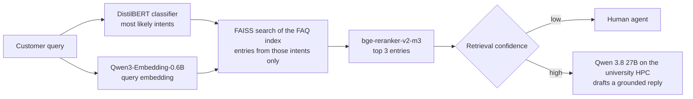

# Intelligent Customer Support Assistant

CS6120 Natural Language Processing · Final Project
Team: Jiarui Zha, Sijing Zhang, Xueyan Zhang, Wenjie Liu

> **Draft · 11/23.** Written from our project proposal. One change from the proposal: the reply generator is **Qwen 3.8 27B**, not 24B.

## What it does

A customer support assistant for banking. A customer types a question in plain language, such as why a card payment was declined. The system:

1. identifies what the customer needs (one of 77 banking intents),
2. finds the closest entries in an FAQ knowledge base, and
3. drafts a suggested reply grounded in those entries, or passes the query to a human agent when retrieval confidence is low.

Support teams answer the same kinds of questions over and over, so fast, accurate routing saves time for both agents and customers. The task is also hard in an interesting way: many of the 77 intents are very similar, so telling them apart is a real challenge.

## Data

| Source | Contents | Use |
|---|---|---|
| [BANKING77](https://huggingface.co/datasets/PolyAI/banking77) (PolyAI) | 13,083 customer service queries labeled with 77 banking intents: 10,003 train, 3,080 test | Train and evaluate the intent classifiers |
| FAQ knowledge base (ours) | Common banking questions and their answers, written by hand and organized by intent | Retrieval target, and a test of how well queries are matched to relevant FAQ entries |

The intents cover common banking issues such as declined card payments, cash withdrawals, account transfers and card activation.

BANKING77 is committed with the repo in [data/banking77/](data/banking77/), so every script and teammate uses the same copy:

| File | Contents |
|---|---|
| `train.parquet`, `test.parquet` | Columns `text` and `label` (an intent id, 0–76) |
| `labels.csv` | Intent id → name, for example `0,activate_my_card` |
| `README.md` | The dataset card from Hugging Face |

It is the Hugging Face version at revision `1846984`, and both files match Hugging Face's SHA-256 hashes. The data is © PolyAI under CC-BY-4.0; cite Casanueva et al. (2020) when you use it. Two intent names are spelled as in the original: `Refund_not_showing_up` and `reverted_card_payment?`.

## NLP tasks

**1. Intent classification.** Classify each query into one of the 77 BANKING77 intents.

- Baseline: TF-IDF + Logistic Regression
- Main model: fine-tuned DistilBERT
- Evaluation: accuracy, macro-F1, and a confusion matrix to analyze errors between similar intents

**2. Semantic FAQ retrieval.** Match each query to semantically similar entries in the FAQ knowledge base.

- Main retriever: Qwen3-Embedding-0.6B with a FAISS index, followed by the bge-reranker-v2-m3 cross-encoder
- Baselines: BM25 and MiniLM
- Evaluation: Recall@k and MRR

**3. Grounded reply generation (extension).** An LLM drafts a suggested reply grounded in the retrieved FAQ content.

## Architecture

A retrieval-augmented generation (RAG) pipeline:

1. The fine-tuned DistilBERT classifier predicts the most likely intents for the query.
2. The query is embedded with Qwen3-Embedding-0.6B and searched against a FAISS index of the FAQ knowledge base, keeping only entries from those intents.
3. The bge-reranker-v2-m3 cross-encoder selects the top three entries.
4. If retrieval confidence is low, the query is passed to a human agent. Otherwise, Qwen 3.8 27B, deployed on the university HPC, drafts a reply grounded in the retrieved FAQs.

## Models

| Role | Model |
|---|---|
| Intent classifier | DistilBERT, fine-tuned on BANKING77 |
| Classifier baseline | TF-IDF + Logistic Regression |
| Query and FAQ embeddings | [Qwen3-Embedding-0.6B](https://huggingface.co/Qwen/Qwen3-Embedding-0.6B) |
| Vector index | FAISS |
| Reranker | [bge-reranker-v2-m3](https://huggingface.co/BAAI/bge-reranker-v2-m3) (cross-encoder) |
| Retrieval baselines | BM25, MiniLM |
| Reply generator | [Qwen 3.8 27B](https://huggingface.co/Qwen/Qwen3.8-27B) (`Qwen/Qwen3.8-27B`), served on Northeastern's Explorer HPC cluster. *Updated 11/23: the proposal said 24B.* |

## Evaluation plan

| Component | Comparison | Metrics |
|---|---|---|
| Intent classification | TF-IDF + Logistic Regression vs. fine-tuned DistilBERT | Accuracy, macro-F1, confusion matrix |
| FAQ retrieval | Qwen3-Embedding-0.6B + FAISS + reranker vs. BM25 and MiniLM baselines | Recall@k, MRR |

## Status (11/23)

Setup on Explorer is done; the project work itself starts next.

- [x] Project proposal
- [x] Models and BANKING77 downloaded to Explorer
- [x] Qwen 3.8 27B serving on Explorer: smoke tests pass on H200 and A100 80GB
- [x] Python environment for retrieval and classification, checked on CPU and on an H200
- [ ] FAQ knowledge base
- [ ] TF-IDF + Logistic Regression baseline (an untuned sanity fit already reaches 0.857 test accuracy)
- [ ] DistilBERT fine-tuning
- [ ] Retrieval pipeline and baselines
- [ ] End-to-end demo
- [ ] Later, optional: faster Qwen replies with its multi-token prediction layer (`MTP=2`)

## Running on Explorer

Everything runs as SLURM jobs from the repo root on Explorer. Large files live in `/scratch/$USER/cs6120`.

| Step | Command | Runs on | What it does |
|---|---|---|---|
| 1. Models | `mkdir -p logs && sbatch slurm/fetch_models.slurm` | CPU (`short`), ~11 min | Downloads Qwen3-Embedding-0.6B, bge-reranker-v2-m3, DistilBERT and MiniLM, checks every file, and links the Qwen 3.8 27B weights (BANKING77 comes with the repo) |
| 2. Python env | `sbatch slurm/build_rag_env.slurm` | CPU (`short`), ~12 min | Builds the env from `requirements.txt`, runs `scripts/check_rag_env.py`, writes `requirements-lock.txt` |
| 3. Qwen smoke test | `sbatch slurm/serve_qwen.slurm` | H200 (`gpu-short`) | Starts Qwen, runs `scripts/smoke_qwen.py`, stops |
| 4. Qwen server | `bash slurm/submit_qwen.sh h200 serve` | H200 (`gpu-short`), 2 h | Serves an OpenAI-compatible API; the job log prints the SSH tunnel command |

For an A100 80GB instead, use `bash slurm/submit_qwen.sh a100 smoke` or `a100 serve`.

Things to know:

- **Load the module before using the env:** `module load python/3.13.5`, then run `/scratch/$USER/cs6120/venvs/rag/bin/python`. The env's Python needs the module's `libpython`.
- **torch stays at 2.10.0**, the last PyPI release built for CUDA 12.8. Explorer's GPU driver (570) can't run the CUDA 13 builds of 2.11 and later.
- **The Qwen server reuses Jiarui's account:** its vLLM 0.19.1 environment and the Qwen weights already exist there. Another account would need its own copies (the weights are 55.6 GB).
- **Thinking is off by default, and requests need an API key.** Each server job writes its address and a new key to `/scratch/$USER/cs6120/run/qwen_endpoint_<job>.env`, readable only by its owner.
- **Startup takes about 5–15 minutes**, mostly reading the weights, so start a demo server early.
- **Scratch is purged monthly** (the first Tuesday). Afterwards, rerun steps 1 and 2 (`REBUILD=1` if the env broke); the next Qwen start recompiles kernels for 5–8 minutes.

Qwen 3.8 27B measured on 11/23 (BF16, vLLM 0.19.1, thinking off):

| GPU | Time to first token | One reply | 8 requests at once |
|---|---|---|---|
| H200 | 0.51 s | 63 tokens/s | 285 tokens/s combined |
| A100 80GB | 0.56 s | 28 tokens/s | 49 tokens/s combined (likely a busy node) |

## References

- Casanueva et al., 2020. [Efficient Intent Detection with Dual Sentence Encoders](https://arxiv.org/abs/2003.04807). Introduces the BANKING77 dataset.
