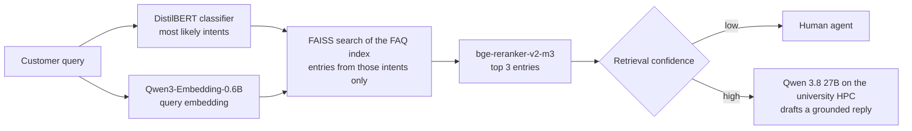

# Intelligent Customer Support Assistant

CS6120 Natural Language Processing · Final Project
Team: Jiarui Zha, Sijing Zhang, Xueyan Zhang, Wenjie Liu

> **Draft · 11/23.** Written from our project proposal. One change from the proposal: the reply generator is **Qwen 3.8 27B**, not 24B.

## What it does

A customer support assistant for banking. A customer types a question in plain language, such as why a card payment was declined. The system:

1. identifies what the customer needs (one of 77 banking intents),
2. finds the closest entries in an FAQ knowledge base, and
3. drafts a suggested reply grounded in those entries, or passes the query to a human agent when retrieval confidence is low.

Support teams answer the same kinds of questions over and over, so fast, accurate routing saves time for both agents and customers. The task is also hard in an interesting way: many of the 77 intents are very similar, so telling them apart is a real challenge.

## Data

| Source | Contents | Use |
|---|---|---|
| [BANKING77](https://huggingface.co/datasets/PolyAI/banking77) (PolyAI) | 13,083 customer service queries labeled with 77 banking intents: 10,003 train, 3,080 test | Train and evaluate the intent classifiers |
| FAQ knowledge base (ours) | Common banking questions and their answers, written by hand and organized by intent | Retrieval target, and a test of how well queries are matched to relevant FAQ entries |

The intents cover common banking issues such as declined card payments, cash withdrawals, account transfers and card activation.

## NLP tasks

**1. Intent classification.** Classify each query into one of the 77 BANKING77 intents.

- Baseline: TF-IDF + Logistic Regression
- Main model: fine-tuned DistilBERT
- Evaluation: accuracy, macro-F1, and a confusion matrix to analyze errors between similar intents

**2. Semantic FAQ retrieval.** Match each query to semantically similar entries in the FAQ knowledge base.

- Main retriever: Qwen3-Embedding-0.6B with a FAISS index, followed by the bge-reranker-v2-m3 cross-encoder
- Baselines: BM25 and MiniLM
- Evaluation: Recall@k and MRR

**3. Grounded reply generation (extension).** An LLM drafts a suggested reply grounded in the retrieved FAQ content.

## Architecture

A retrieval-augmented generation (RAG) pipeline:

1. The fine-tuned DistilBERT classifier predicts the most likely intents for the query.
2. The query is embedded with Qwen3-Embedding-0.6B and searched against a FAISS index of the FAQ knowledge base, keeping only entries from those intents.
3. The bge-reranker-v2-m3 cross-encoder selects the top three entries.
4. If retrieval confidence is low, the query is passed to a human agent. Otherwise, Qwen 3.8 27B, deployed on the university HPC, drafts a reply grounded in the retrieved FAQs.

## Models

| Role | Model |
|---|---|
| Intent classifier | DistilBERT, fine-tuned on BANKING77 |
| Classifier baseline | TF-IDF + Logistic Regression |
| Query and FAQ embeddings | [Qwen3-Embedding-0.6B](https://huggingface.co/Qwen/Qwen3-Embedding-0.6B) |
| Vector index | FAISS |
| Reranker | [bge-reranker-v2-m3](https://huggingface.co/BAAI/bge-reranker-v2-m3) (cross-encoder) |
| Retrieval baselines | BM25, MiniLM |
| Reply generator | [Qwen 3.8 27B](https://huggingface.co/Qwen/Qwen3.8-27B) (`Qwen/Qwen3.8-27B`), served on Northeastern's Explorer HPC cluster. *Updated 11/23: the proposal said 24B.* |

## Evaluation plan

| Component | Comparison | Metrics |
|---|---|---|
| Intent classification | TF-IDF + Logistic Regression vs. fine-tuned DistilBERT | Accuracy, macro-F1, confusion matrix |
| FAQ retrieval | Qwen3-Embedding-0.6B + FAISS + reranker vs. BM25 and MiniLM baselines | Recall@k, MRR |

## Status (11/23)

- [x] Project proposal
- [ ] FAQ knowledge base
- [ ] TF-IDF + Logistic Regression baseline
- [ ] DistilBERT fine-tuning
- [ ] Retrieval pipeline and baselines
- [ ] Qwen 3.8 27B serving on Explorer (weights are already downloaded there)
- [ ] End-to-end demo

## References

- Casanueva et al., 2020. [Efficient Intent Detection with Dual Sentence Encoders](https://arxiv.org/abs/2003.04807). Introduces the BANKING77 dataset.
